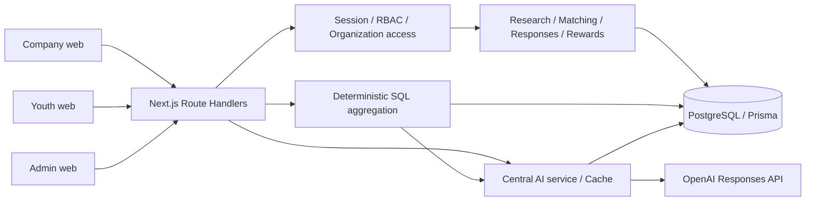

# Veyra

Платформа исследований молодёжной аудитории: компания публикует исследование, подходящие участники отвечают в коротком диалоге и получают внутренние баллы, а команда видит статистику и AI-интерпретацию.

## Реализовано

- Регистрация компании и респондента с onboarding и явным согласием, вход и выход.
- Защищённые кабинеты COMPANY / RESPONDENT / ADMIN.
- Wizard из семи шагов: описание, аудитория, вопросы, видимость, награда, проверка, публикация.
- Пять типов вопросов, обязательность, удаление и перестановка.
- Серверный matching, статусы Draft / Active / Paused / Completed / Archived.
- Mobile-first прохождение по одному вопросу, возврат назад, подтверждение завершения.
- Ответы и баллы в единой транзакции; ledger и уникальные ограничения предотвращают повторную награду.
- Детерминированные графики, демография, фильтры, пагинация ответов.
- AI-анализ с кешем, индикатором устаревания и подтверждёнными цитатами; отдельный разговор по каждому исследованию.
- Private, Open и Shared с явным разрешением публикации агрегатов.
- Профиль, удаление аккаунта и связанных данных, жалобы и минимальная модерация.
- 5 организаций, 25 исследований, 125 демореспондентов, 432 ответа и 432 начисления на чистой БД; редакционные примеры инсайтов явно помечены.

## Архитектура

Модульный монолит: Next.js App Router, React, TypeScript strict, Prisma 6, PostgreSQL 16+, Zod, bcrypt, OpenAI Responses API, Recharts, Lucide. Простой собственный CSS component system вместо Tailwind/shadcn и контролируемые React-формы вместо React Hook Form: меньше зависимостей, достаточная сложность для этого MVP. Zod остаётся обязательным на сервере.



### Структура

- `src/app`: маршруты Next.js, landing, privacy, company, youth, admin, API.
- `src/components`: переиспользуемые компоненты и пользовательские сценарии.
- `src/lib`: auth, domain, research, analytics, AI, database.
- `prisma/schema.prisma`: нормализованная схема; `prisma/migrations`: миграции.
- `prisma/seed.ts` и `prisma/seed-expanded.ts`: повторяемая загрузка базовых и дополнительных демонстрационных данных.
- `tests`: unit и Playwright E2E / API integration.
- `scripts/check-secrets.mjs`: проверка Git-индекса, исходников и browser bundle.

### База

User, Session, RespondentProfile, Organization, OrganizationMember, Research, ResearchTarget, Question, QuestionOption, ResearchParticipant, Response, Answer, AnswerSelection, RewardTransaction, AIAnalysis, AIConversation, AIMessage, Flag, RateLimit.

Демографический срез сохраняется при завершении. Ответы нормализованы: варианты — через AnswerSelection. JSON используется только для AI-результата. Индексы по статусу, организации, участнику, вопросам, демографии и времени. Баланс вычисляется из ledger. Сохранение ответа блокирует строку исследования и атомарно создаёт Response и RewardTransaction.

## Запуск

Нужны Node.js 22+, npm 10+, PostgreSQL 16+ или Docker Compose.

**Не перезаписывайте имеющийся .env с ключом.** Если файла нет:

```sh
cp .env.example .env
```

Укажите DATABASE_URL. Для PostgreSQL через Docker:

```sh
docker compose up -d db
npm ci
npm run db:generate
npm run db:migrate
npm run db:seed
npm run dev
```

Открыть **http://localhost:3000**. Origin должен совпадать с APP_ORIGIN.

Полностью контейнерный запуск (проверен 1 октября 2026). Перед seed задайте переменную DEMO_PASSWORD в окружении терминала — приватный пароль не короче 16 символов. В production используется этот пароль вместо локального демопароля:

```sh
docker compose up --build -d
docker compose exec -e ALLOW_DEMO_SEED=true -e DEMO_PASSWORD app npm run db:seed
```

Если порт 3000 занят, в PowerShell перед командами Compose задайте `$env:APP_PORT="3002"`; затем открывайте http://localhost:3002. Аналогично `DB_PORT` меняет внешний порт БД. Данные контейнерной БД хранятся в volume postgres_data независимо от локальной БД на 55432.

Compose предназначен для локальной демонстрации и слушает loopback. Перед production смените пароль БД, включите TLS и secure cookies, уберите публикацию порта БД. Миграции выполняются при старте app. Seed автоматически не запускается.

Production build локально:

```sh
npm run build
npm run start
```

### Текущее локальное окружение Windows

В ходе разработки создан изолированный кластер PostgreSQL 16 в `.data/postgres`, порт **55432**, loopback. Системная служба PostgreSQL не изменялась. В локальном .env уже указан его URL. После перезагрузки при необходимости:

```powershell
& 'C:\Program Files\PostgreSQL\16\bin\pg_ctl.exe' -D C:\Comesh\.data\postgres -l C:\Comesh\.data\postgres.log -o '-p 55432 -h 127.0.0.1' start
npm run start
```

Это только среда разработки с локальной trust-аутентификацией; для развёртывания используйте пароль и приведённый Compose.

## Переменные среды

- DATABASE_URL — строка PostgreSQL.
- APP_ORIGIN — точный origin UI; по умолчанию локально http://localhost:3000.
- APP_PORT / DB_PORT — внешние порты Compose, по умолчанию 3000 / 5432. В Compose APP_ORIGIN автоматически соответствует APP_PORT.
- OPENAI_API_KEY — только серверный секрет; приложение работает без него.
- OPENAI_MODEL — по умолчанию gpt-5-nano.
- AI_MAX_OUTPUT_TOKENS — 2200, верхняя граница 4000.
- COOKIE_SECURE — true для HTTPS; false допускается только для локального HTTP.
- ALLOW_DEMO_SEED — explicit opt-in для seed при NODE_ENV=production.
- POSTGRES_PASSWORD — пароль БД в Compose; локальное значение по умолчанию не подходит для production.

## Demo

Для сервера **https://45.149.234.64/** используется отдельный приватный пароль из [.data/nl-access.md](.data/nl-access.md). Логины ниже работают на сервере с этим паролем. Сам пароль исключён из Git.

Пароль **только локальных** демонстрационных аккаунтов при dev-seed: **VeyraDemo2026!**. На новом VDS он не действует.

- Forma Studio: **company@example.com**
- Nova Play (игры): **nova@example.com**
- Mira Care (косметика): **mira@example.com**
- Loop Market (покупки): **loop@example.com**
- Orbit Learning (обучение): **orbit@example.com**
- Респондент, 18 лет: **teen@example.com**
- Респондент, 12 лет: **teen12@example.com**
- Респондент, 99 лет: **senior99@example.com**
- Другие респонденты: **participant1@example.com** … **participant24@example.com**, **demo.user001@example.com** … **demo.user098@example.com**
- Администратор: **admin@example.com**

У каждой дополнительной организации есть пять разных исследований: Active, Completed, Paused, Draft и Archived, со всеми типами вопросов и разной видимостью. Данные включают демографические срезы, начатые и завершённые участия, баллы, открытые и закрытые жалобы. Подростковые активные опросы доступны аккаунту teen12@example.com; ранее созданные опросы сохраняют свою целевую аудиторию.

Чистый seed создаёт 131 аккаунт: 5 компаний, 125 респондентов и одного администратора; 25 исследований и 432 завершённых ответа. В уже используемой базе количество может быть выше. Повторный запуск не дублирует эти записи.

Seed создаёт только вымышленные данные и не перезаписывает существующие аккаунты. Не запускайте его в production с реальными пользователями.

## AI

OpenAI вызывается только сервером. Модель задаётся в одном configuration layer. gpt-5-nano выбрана как дешёвая модель для суммаризации и классификации; официальная документация: https://developers.openai.com/api/docs/models/gpt-5-nano . Structured Outputs: https://developers.openai.com/api/docs/guides/structured-outputs .

Сначала SQL/код считает статистику. Затем передаются ограниченные распределения, четыре возрастных сегмента (12–17, 18–21, 22–30, 31–99) и до 30 текстовых ответов по 400 символов. Email, nickname и auth data не передаются. Очевидные контакты маскируются; произвольные персональные сведения в свободном тексте требуют дополнительной модерации перед production.

Вывод валидируется схемой Zod. AI возвращает answerId цитат, а сервер подставляет только существующий текст. Незнакомый ID вызывает ошибку, не публикацию выдуманной цитаты. В результатах разделены наблюдения, рекомендации и ограничения. Числа вычисляет backend, но смысловые утверждения LLM всё равно требуют проверки человеком.

Кеш по fingerprint агрегатов, сегментов и выборки. AI не вызывается при render. Обновление — вручную; при изменении данных показано stale. Assistant ограничен одним принадлежащим организации исследованием и шестью последними сообщениями, история хранится в БД. Запросы имеют timeout 90 секунд без автоматического повтора и лимит вывода; Responses store=false. Лимит: 8 AI-запросов на пользователя за час. Без ключа и при ошибке провайдера обычная аналитика продолжает работать.

## Безопасность и privacy

- .env и .env.* исключены из Git и Docker; .env.example без секрета.
- Проверка секретов: `npm run security:check`. Установите pre-commit hook: `git config core.hooksPath .githooks`.
- bcrypt cost 12, случайная opaque session cookie, в БД только SHA-256 токена, срок 7 дней.
- HttpOnly, SameSite=Lax, Secure для production HTTPS.
- Server-side role/organization checks на каждом ресурсе; чужой private resource возвращает 404.
- Mutation-запросы проверяют Origin и JSON content type. CORS не открывается.
- Zod validation, запросы через Prisma и параметризованный SQL, лимит тела 64 KiB.
- Общий и account-based auth rate limits в PostgreSQL; проксируемым IP-заголовкам не доверяем.
- React escaping, CSP, frame denial, nosniff, referrer / permissions policy.
- Не логируются ключи, пароли, токены и пользовательские payload.
- Account deletion каскадно удаляет профиль, ответы, награды, сессии; затронутые AI-анализы и разговоры также удаляются. Последний member организации удаляет её исследования.
- Consent version и parentalConsentStatus заложены в модель. Регистрация доступна в диапазоне 12–99. У пользователей младше 18 лет parentalConsentStatus=UNVERIFIED; это не подтверждение родительского согласия.

Ни UI, ни этот README не заявляют соответствия конкретному законодательству. **Перед production обязательна юридическая проверка обработки данных несовершеннолетних, персональных данных и условий AI-провайдера.**

## Проверки

```sh
npm run typecheck
npm run lint
npm test
npm run build
npm run security:check
npm audit
npx playwright install chromium
npm run test:e2e
```

Для E2E запустите приложение на localhost:3000 и выполните seed. Для другого адреса задайте PLAYWRIGHT_BASE_URL, например http://localhost:3002 для Docker. Тесты используют реальную PostgreSQL, создают тестовые аккаунты и исследования. Не направляйте их на production. В Windows можно указать PLAYWRIGHT_CHROMIUM_EXECUTABLE с путём к Chrome.

По умолчанию E2E не делает внешних AI-запросов. `RUN_LIVE_AI=1 npm run test:e2e` включает один анализ и один вопрос по отдельному исследованию с одним синтетическим ответом. Это тратит небольшой объём API-токенов. Фактические результаты проверок перечислены в `VERIFICATION.md`.

## Осознанные ограничения MVP

- Нет выплат, gift cards, voice recording/STT, PDF, realtime push и командных приглашений.
- Голосовой ввод имеет только расширяемый интерфейс `AnswerInputProvider`; кнопки записи нет.
- Нет email verification / password reset / MFA; перед внешним запуском обязательны.
- Возраст вводится пользователем; проверка возраста и родительское согласие ещё не реализованы, диапазон регистрации — 12–99 лет.
- После перезагрузки незавершённого опроса ответы вводятся заново; факт старта сохраняется.
- Опубликованный опрос не редактируется, чтобы не менять смысл уже собранных данных.
- AI-выборка ограничена, это не полноценный статистический тематический анализ всех текстов.
- Общий список исследований ограничен 100, библиотека — 60, ledger UI — 100 операций. Индивидуальные ответы пагинируются по 20.
- Регион / интересы задаются текстом, без единого справочника; matching требует совпадения интересов.
- Нужны политика retention, cleanup просроченных сессий/rate buckets, резервные копии, мониторинг и abuse protection.
- CSP допускает inline script/style для Next.js; nonce-based CSP — production improvement.

## Следующие шаги

1. Email verification, password reset, MFA.
2. Юридическая проверка и age/parental-consent flow.
3. Модерация свободного текста и более надёжная PII-защита.
4. AI evals для числовых утверждений, сегментов и рекомендаций.
5. Фоновые задания AI, дедупликация параллельных запросов.
6. Autosave незавершённых ответов и draft editing с версиями.
7. Invitations и права команды организации.
8. Пагинация всех списков, индексы GIN при росте массивов интересов.
9. Retention, backups, observability и нагрузочные тесты.
10. Partner rewards после проверки продуктовой экономики.

## Развёртывание на VPS

Серверная конфигурация, адрес, эксплуатационные команды и резервное копирование описаны в [deploy/README.md](deploy/README.md). Серверные демопароли хранятся отдельно в приватном файле .data/vps-access.md.

Новый VDS: https://45.149.234.64/. Актуальные команды: [deploy/README.production.md](deploy/README.production.md). Приватные демодоступы: .data/nl-access.md.


## Опрос в формате чата

Респондент сначала видит описание исследования, время и награду; участие начинается только после кнопки «Начать опрос». Вопросы компании и отправленные ответы остаются в одной переписке. Поддерживаются выбор одного или нескольких вариантов, оценка, да/нет и свободный текст. До завершения можно вернуться к ответу и изменить его; баллы начисляются только после сохранения всей анкеты. Черновик хранится в памяти страницы и сбрасывается при перезагрузке. Чат следует вопросам компании; свободный разговор с генерацией новых вопросов AI в этот режим не входит.


## Git и GitHub

Репозиторий содержит исходники, миграции, тесты, документацию, Docker-конфигурацию и публичные файлы лендинга.
Секретные .env, .data, резервные копии, ключи, зависимости, сборки и тестовые отчёты исключены.
В .env.example находятся только примеры локальных настроек, без рабочего API-ключа.
После клонирования включите проверку коммитов: `git config core.hooksPath .githooks`.
Проверка `npm run security:check` сканирует содержимое Git-индекса, исходники и браузерную сборку; секреты в сообщениях ошибок не печатаются.

Для подключения к новому **пустому** репозиторию GitHub (не добавляйте README или .gitignore при создании):

```powershell
git remote add origin https://github.com/USERNAME/REPOSITORY.git
git push -u origin main
```

Замените USERNAME и REPOSITORY своими значениями. GitHub может запросить вход через Git Credential Manager.
Авторизацию или токен не добавляйте в URL и файлы проекта.

## Начало работы

На информационном лендинге есть отдельные кнопки регистрации компании и участника, а также вход для существующих пользователей.
Приложение содержит обратную ссылку «О проекте». Логотип и текст поддержки ФСИ остаются без внешней ссылки.
После успешной регистрации показываются приветствие и короткий салют; при prefers-reduced-motion анимация отключается.
